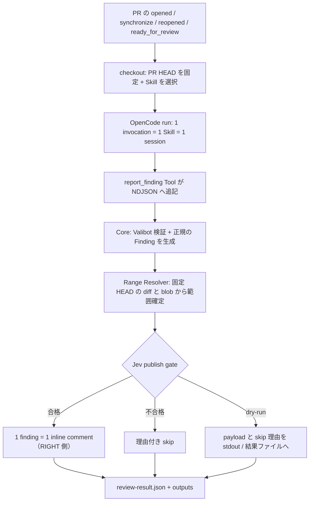

# opencode-review

> OpenCode CLI（`opencode run`）にリポジトリ固有の Skill を適用して PR を調査させ、Core が指摘内容とコメント範囲を検証し、Jev（TypeSafe System One 系モデル）の publish gate を通過した finding だけを GitHub の inline review comment として投稿する GitHub Action。

実装は完了しているが、配布はまだ行われていない（`uses:` で参照する公開リポジトリと tag / SHA は存在しない）。

## これは何か

- **やること**: `pull_request`（opened / synchronize / reopened / ready_for_review）で起動し、1 invocation = 1 Skill = 1 OpenCode session で PR を調査させる。`report_finding` Tool で受け取った候補を Core の Valibot 検証・Range Resolver・Jev publish gate にかけ、通過した 1 finding を 1 件の inline review comment として固定 HEAD の `RIGHT` 側へ投稿する。dry-run は投稿以外の全検証を実行する。
- **やらないこと**: 総合 summary コメント、APPROVE / REQUEST_CHANGES、過去レビューの更新・削除、AI の自由文から構造化データを復元する処理、有料 model への自動 fallback。投稿は finding 単位の inline comment のみ。

## 実行の流れ

PR イベントから comment 投稿までに、Core が指摘を検証する。



投稿されるコメント本文は `[severity] title`（空行）`body` の 1 形式で、severity は `critical` / `high` / `medium` / `low`。次の例は形式の説明用で、実際の文面は Skill と model が作る。

```text
[high] increment が 1 小さい値を返す

increment() は n + 1 ではなく n - 1 を返しています。呼び出し側は常に 1 少ない値を受け取ります。
```

## クイックスタート（テンプレート）

このアクションはまだリリースされていないため、以下はテンプレートです。`uses:` の40桁プレースホルダは、公開後にあなたがレビューしたcommit SHAへ置き換えるまで動作しません

1. [`examples/pr-review.yml`](examples/pr-review.yml) を自分のリポジトリへコピーする。
2. リポジトリの Actions secret に `OPENCODE_API_KEY` を設定する（取得方法は[API鍵の入手](docs/overview.md#api鍵の入手)）。この 1 つの credential が Jev publish gate の認証と、provider が `opencode` / `opencode-go` の model（無料 model 含む）の review model 認証を兼ねる。有料 provider への自動 fallback はない。
3. `uses:` を、公開後に自分でレビューした 40 桁の commit SHA へ置き換える（可動 tag ではなく commit SHA 固定を推奨）。

最小構成の例:

```yaml
name: Skill review
on:
  pull_request:
    types: [opened, synchronize, reopened, ready_for_review]

permissions:
  contents: read
  pull-requests: write

jobs:
  review:
    if: >-
      !github.event.pull_request.draft &&
      github.event.pull_request.head.repo.full_name == github.repository
    runs-on: ubuntu-latest
    steps:
      - uses: actions/checkout@v6
        with:
          ref: ${{ github.event.pull_request.head.sha }}
          fetch-depth: 0
          persist-credentials: false

      - name: Install OpenCode
        run: npm install -g @opencode/cli@2.0.22

      - name: Review
        uses: OWNER/opencode-review@0000000000000000000000000000000000000000  # テンプレート: 公開後に commit SHA へ置換
        with:
          skill: security-review
          model: opencode/space-bunny-free
          github-token: ${{ github.token }}
        env:
          OPENCODE_API_KEY: ${{ secrets.OPENCODE_API_KEY }}
```

テストした model（`opencode/space-bunny-free`）では anchor の先頭空白欠落により finding が全件スキップされ、**コメント 0 件でも run が成功**しうる。詳細は[既知の制限と較正](docs/architecture.md#既知の制限と較正)を参照。

## 入出力

Inputs は 9 個、outputs は 5 個。詳細と検証規則は[ツール概要](docs/overview.md#actionインターフェースactionyml-で定義)を参照。

| Input | 必須 / 既定 | 内容 |
| --- | --- | --- |
| `skill` | 必須 | `.opencode/skills/<name>/SKILL.md` の Skill 名（パスではない） |
| `model` | 必須 | `provider/model[#variant]` |
| `dry-run` | `false` | `"true"` / `"false"` のみ。`true` は投稿せず全検証と payload 出力 |
| `github-token` | 実質必須（空文字は拒否） | metadata 読み取りと inline 投稿。dry-run でも必要。子プロセスへは渡さない |
| `jev-model` | `jev-1.13-free` | Jev 検証 model（`jev-1.13-free` / `jev-1.13`） |
| `supported-threshold` | `0.7` | `supported >= この値` で gate 通過 |
| `comment-worthy-threshold` | `0.6` | `commentWorthy >= この値` で gate 通過 |
| `timeout-seconds` | `600`（1–3600） | OpenCode 実行時間の上限 |
| `max-findings` | `100`（1–1000） | 1 invocation の受付上限 |

| Output | 内容 |
| --- | --- |
| `accepted-count` | Core に受理された finding 数 |
| `publishable-count` | publish gate を通過した finding 数 |
| `published-count` | 投稿した inline comment 数（dry-run は 0） |
| `skipped-count` | 理由付きで skip した finding 数 |
| `result-path` | 結果ファイル `review-result.json` のパス（runner 内。自動 upload はない） |

## 対応範囲

GitHub-hosted Ubuntu runner 上の、同一リポジトリかつ non-draft の PR のみを対象とする。fork PR は secrets と書き込み権限が制限されるため**非対応**で、run error（stage=`repository`）として失敗する。`pull_request_target` で PR のコードを実行する構成は採らない。理由は[設計判断](docs/decisions.md) D25 を参照。

## 開発

開発環境は Node.js **26.8.2**・pnpm **12.6.0** を `vp` で固定する。主要コマンドは `vp run typecheck` / `vp run test` / `vp run build` / `vp run build:verify` / `vp run bundle:check`。詳細は[開発環境](docs/development.md)を参照。

## ドキュメント

| 文書 | 内容 |
| --- | --- |
| [ツール概要](docs/overview.md) | 目的、できること / 保証しないこと、Action 入出力、API 鍵、model 選択、結果の確認 |
| [アーキテクチャ](docs/architecture.md) | 構成図・シーケンス、型、NDJSON、Range Resolver、Jev、publisher / dry-run、トラブルシューティング、既知の制限 |
| [開発環境](docs/development.md) | Node / pnpm の固定、検証コマンド、CI、manual seam、commit / PR 規約 |
| [設計判断](docs/decisions.md) | ID 付きの設計判断（D01–D28 / Q01–Q10）と既知の制限 |
