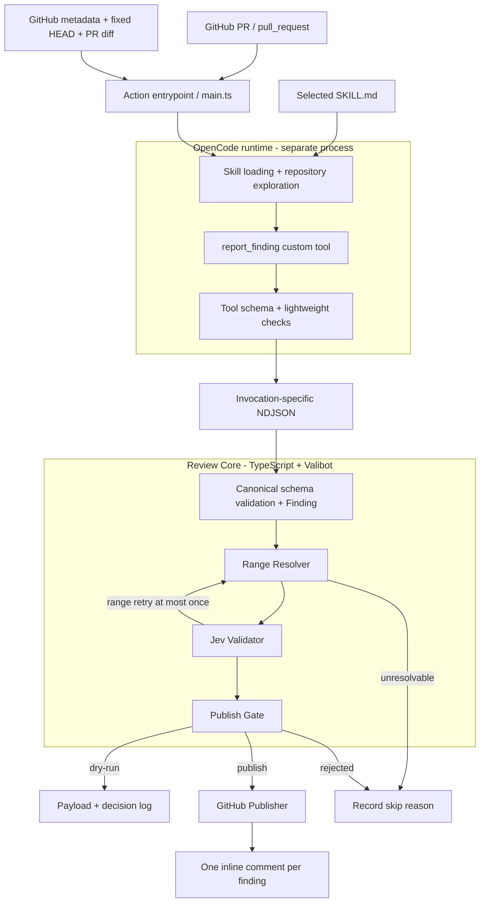
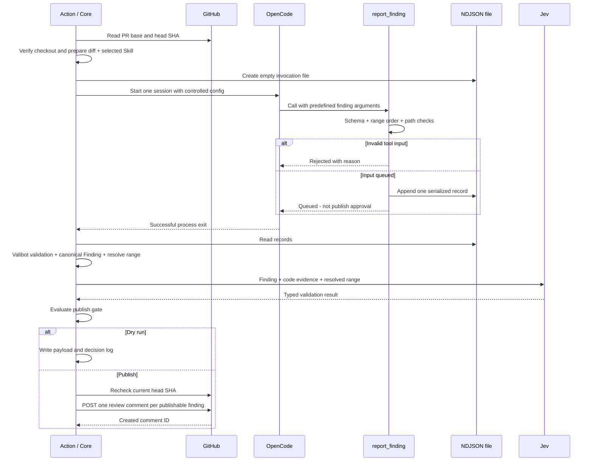

# アーキテクチャ

## 全体構成

ActionがPR contextを確定し、OpenCodeをFinding Producerとして実行する。CoreはToolで渡された候補を検証し、投稿に必要な最終型を生成する。Phase 6（Action配布準備）まで実装済みで、公開・リリースは配布作業時（Q09）。以下は設計図である。



OpenCode依存はSkill discovery/loading、探索Tool、agent loop、model/provider、custom tool登録・実行、プロセス起動設定にある。結果をCoreへ渡す境界だけを`report_finding`に集約する。CoreはOpenCodeのsessionや内部イベント型へ依存しない。

## 正常実行の順序



実装では、全findingを検証して投稿予定を確定した後に投稿を開始する。OpenCodeやJevの実行障害で候補が一部だけ処理された状態では投稿へ進めない。GitHub投稿自体は複数リクエストなので、途中失敗では既に投稿したコメントが残り得る。

## モジュールと依存

```text
action.yml                  # node24 / dist/index.js
src/
  main.ts                   # input / event / pipeline / output / cleanup
  finding.ts                # Valibot schemas / canonical types / gate
  opencode.ts               # runtime / selected Skill / Tool / NDJSON
  range.ts                  # fixed HEAD / diff parser / range resolution
  jev.ts                    # HTTP request / response validation / mapping
  github.ts                 # PR metadata / inline payload / publication
templates/
  report-finding.plugin.ts  # v2 pluginテキストアセット（importなし、esbuildではtextとして同梱）
test/
  fixtures/                 # git diff / findings / Jev / GitHub responses
scripts/
  build.mjs                 # esbuild + bundle size report
dist/
  index.js                  # Action bundle、配布時に追跡
```

このツリーは予定であり、現時点で配置済みのコードを表さない。`main.ts`が各処理をつなぐ。`finding.ts`、`range.ts`、`jev.ts`、`github.ts`は`opencode.ts`や`@opencode/*`をimportしない。

| 区分 | 使用するもの |
| --- | --- |
| Action実行時 | Valibot、Node built-ins、標準`fetch`、外部`git` / `opencode`プロセス |
| 開発時 | TypeScript、esbuild、型定義、必要な検証ツール |
| OpenCode実行時 | OpenCode公式runtime（`@opencode/cli@2.0.22`）、Tool定義はJSON Schemaのみ（`@opencode/plugin` import不要） |

Toolはv2 pluginのテキスト（素の`export default { id, setup }`、importなし）としてbundleへ含め、実行時に配置する。esbuildではtext loaderとして扱い、文字列中の名前をAction依存として解決しない。Actionの外部実行時依存はValibotのみとし、metafileで不要依存が含まれないことを確認する。[v2 Plugins](https://opencode.ai/v2/docs/build/plugins)、[Valibot Introduction](https://valibot.dev/guides/introduction/)

開発環境は`vp`でNode 26.8.2・pnpm 12.6.0を固定する。配布Actionの`using: node24`とは区別し、build targetと利用APIをNode 24へ合わせる。開発用TODO pluginはActionのbundleに含めない。

## 型と値の所有者

以下のTypeScriptは契約の説明用。実装ではValibot schemaを正式な定義とし、`InferOutput`から型を導出する。

```ts
type Severity = "critical" | "high" | "medium" | "low";

type ReportFindingInput = {
  path: string;
  candidateStart: number;
  candidateEnd: number;
  anchor: string;
  severity: Severity;
  title: string;
  body: string;
};

type Finding = {
  id: string;
  skill: string;
  path: string;
  candidateRange: { start: number; end: number; anchor: string };
  severity: Severity;
  title: string;
  body: string;
};

type ResolvedRange = {
  path: string;
  commitId: string;
  startLine: number;
  endLine: number;
  anchorStartLine: number;
  side: "RIGHT";
  code: string;
};

type RangeQuality = "correct" | "too_narrow" | "too_wide" | "wrong_location";

type ValidationResult = {
  supported: number;       // 0–1
  commentWorthy: number;   // 0–1
  rangeQuality: RangeQuality;
};

type PublishableFinding = {
  id: string;
  skill: string;
  path: string;
  commitId: string;
  startLine: number;
  endLine: number;
  side: "RIGHT";
  severity: Severity;
  title: string;
  body: string;
};
```

`id`はCoreが生成し、`skill`は検証済みAction inputから設定する。repository、PR番号、base/head SHAは`ReviewContext`としてCoreが保持する。AI入力にこれらの上書き用フィールドを設けない。

`candidateStart` / `candidateEnd`は1始まりの整数、両端を含むPR HEADの行番号。`anchor`はHEAD内に実在する、連続したコードの原文。説明やMarkdown fenceは含めない。titleは簡潔な問題名、bodyは発生条件・根拠・影響を記述する。

Severityの目安はcritical＝重大な侵害・広範なデータ損失、high＝主要機能の破綻、medium＝特定条件での実害、low＝局所的な実害。重要度だけで投稿を許可しない。好みのスタイル変更は、Skillの要求と実害の根拠がなければ指摘対象にしない。

## `report_finding`とNDJSON

`report_finding`はv2 plugin形式のテキストアセットをAction管理の一時設定領域の`plugins/`へ生成し、`ctx.tool.transform((editor) => editor.add({ ... }))`で登録する。入力はJSON Schema、`options.codemode: false`でCode Modeの入れ子実行を無効にする。ValibotはCoreが結果を正式に受理するためのschemaであり、この2層の役割を混同しない。素の`export default { id, setup }`はimportなしで動作する（2.0.22ローカル実測）。[v2 Plugins](https://opencode.ai/v2/docs/build/plugins)

Toolの役割は、引数の軽い検証、レコードの直列追記、短い結果応答までとする。Jev・投稿・ID発行・Coreの業務処理は置かない。

| 段階 | 検証内容 | 結果 |
| --- | --- | --- |
| Tool schema | 型、整数・正数、severity、必須文字列の空白のみを拒否 | 不正なら呼び出しを拒否 |
| Tool実装 | start ≤ end、許可された変更path、HEAD内の通常ファイル、サイズ上限 | 理由付きRejected、またはQueued |
| Core / Valibot | 許可された全フィールド、未知フィールド拒否、有限整数、文字列制限、フィールド間整合性、変更path・blobの再確認 | 正式Findingを生成、またはreject理由を記録 |

Toolの返答契約案：

```ts
type ToolReceipt =
  | { queued: true }
  | { queued: false; reason: string };
```

Toolはこの値を自分でシリアライズして返す。OpenCodeは即時拒否された入力を修正して再提出できる。**NDJSONではCoreの正式検証はプロセス終了後になるため、Coreのrejectを同じsessionへ即時返すことはできない。** 過去案の`accepted: true / findingId`を即時返すcallback方式は採用しない。

実行ごとに`RUNNER_TEMP`配下へランダムな専用ディレクトリを作り、`findings.ndjson`を空で作成する。1 Tool callにつき1行を`JSON.stringify(input)`で書く。AIへファイルを直接編集させる指示は出さない。ファイル位置はadapterが決める固定値とし、AIの引数にしない。

並行Tool callはTool内のキューで直列化する。追記完了後に`queued: true`を返す。上限案は1レコード32 KiB、ファイル全体4 MiB、件数は`max-findings`。部分行・壊れたJSON・上限超過・ファイル消失は識別して記録し、破損ファイルはrun errorにする。

Actionが空ファイルを事前作成し、OpenCodeが正常終了した場合の0行は正常な「候補なし」。非ゼロ終了・timeoutの後に残ったファイルは成功結果として使わない。プロセス終了・読み取り・検証後、`finally`で一時Toolと作業領域を片付ける。

## OpenCodeの起動とSkill

起動は`opencode run --standalone --format json --agent <review-agent> --model <provider/model> <prompt>`に固定する。`--standalone`は共有background serviceを使わずprivate serverで実行する。1 invocationで新しいsessionを使い、`--continue` / `--session`による継続はしない。CLIイベントは診断目的に限る。[v2 CLI](https://opencode.ai/v2/docs/cli)

指定Skillを選択して固定HEADのコードを探索し、問題ごとに`report_finding`を呼ぶ。正式結果はTool callのみであること、候補範囲はHEAD行番号であることを共通promptへ含める。v2の権限はagent frontmatterの`permissions`配列（順序付き、last match wins）でgatingし、`skill`は`* deny`→選択Skill allowとする。v1の`permission` mapや`options.permission`には依存しない。[v2 Permissions](https://opencode.ai/v2/docs/permissions)

`skill` inputは名前として検証し、ディレクトリ名とfrontmatterのname一致、必須description、実ファイルの存在を確認する。Skill本文には「Base directory for this skill」が付き、相対参照はそのディレクトリへ解決される。選択Skill配下のファイルを読むには`external_directory`の明示allowが必要で、resourceは`<skill dir>/*`の形にする。`*` denyは管理global configへの暗黙許可も上書きする（2.0.22ローカル実測）。

隔離レシピ（2.0.22ローカル実測、Docker・macOS）: 専用のtemp HOMEを作り、`$HOME/.config/opencode`に管理するconfig・agent・skill・pluginだけを置く。`XDG_CONFIG_HOME=$HOME/.config`、`OPENCODE_DISABLE_PROJECT_CONFIG=1`とし、作業ディレクトリとPWDを一致させた`.git`なしworkspaceで起動する。場所発見はPWD基準。`/etc/opencode`は2.0.22では読まれない。PR側のconfig / custom tool / pluginは実行されず、`.env`も読み込み・継承されないことをdecoyとenv名で確認した。[v2 Config](https://opencode.ai/v2/docs/config)

固定HEADのコード閲覧は一時レビュー作業領域で行い、選択SkillとAction管理Toolだけを配置する。レビューruntimeにはコード閲覧・検索・指定Skill・`report_finding`を許可し、ファイル変更・汎用shell・外部連携Tool・subagentを許可しない構成を採用する。

## Range Resolver

コメントの位置はAIの行番号をそのまま信用せず、同じHEADのblobとPR diffから決定する。

1. イベントとGitHub metadataのHEADを照合し、checkoutを固定する。取得したbase SHAとHEADからmerge-baseを算出する。
2. merge-baseとHEADを比較したdiffを読み、各pathのhunkと新側の行番号を構成する。GitHubの変更ファイル一覧もページ末尾まで取得し、照合する。実行中にHEADが変わった場合は止める。
3. pathはGitのHEAD側pathに完全一致させる。絶対path、`..`、NUL、repo外参照、symlink・submoduleを拒否する。空白や日本語を含むpathは扱い、shellに補間しない。
4. HEADのblobを読み、行番号とanchorを照合する。行末CRLFだけを統一し、空白のtrim・fuzzy matchはしない。
5. 候補範囲内にanchorが完全一致すればその位置を優先する。候補行がずれていた場合は、同じfile内でanchorが一意に完全一致するときだけ位置を補正する。候補外に複数一致した場合は推測しない。
6. anchorを含む最小範囲を基本とし、根拠を示す必要がある連続範囲を確定する。範囲全体が同一hunkの`RIGHT`行としてdiffに存在し、少なくとも1行の追加・変更行を含むことを確認する。
7. `ResolvedRange`にpath・固定HEAD SHA・確定行・原文codeを格納する。Jevへは周辺の証拠も送るが、コメント範囲と証拠範囲を区別する。

renameは新側pathを使う。HEADに存在しない削除file、binary、diff範囲外、別hunkをまたぐ範囲、anchor不在・曖昧、照合不能なdiffはskip理由を残す。hunk headerがないpatchを無理に復元しない。

Phase 3で確定した最小範囲規則: anchor窓（完全一致した連続行）を基準とし、同一hunk内で直接隣接するadded行の最大連続runだけを拡張して含める。runを超えるcontext行は含めず、窓がcontextのみで隣接addedがなければ`no_changed_line_in_range`としてskipする。範囲はanchorの位置合わせにのみAI指定を使う。範囲不合格時の補正は、`too_wide`＝anchor窓への縮小、`too_narrow`＝同一hunk内の隣接added runを現在範囲から±3行capで拡張とし、前回と同じ範囲・解決不能・2回目は`range_retry_exhausted`とする（decisions.md Q07）。

初期は`git diff --no-ext-diff --no-textconv`の出力を用い、runner上の外部diff実行に依存しない。GitHub diffとローカルdiffの一致はPhase 3 fixtureで、APIが受け付ける単一行・複数行の範囲はPhase 5の専用PR（2026-10-03、line 2とstart_line 12 / line 14）で確認した。

## Jev ValidatorとPublish Gate

ここでのJevは**TypeSafe AIのSystem One**と確認済み（2026-10-03、公式docsと実サービス）。公式には`state`と型付き`questions`を送るHTTP APIがあり、Noulは0–1の判断値、Choiceは固定選択肢と`probabilities` / `confidence`を返す。[TypeSafe Introduction](https://docs.typesafe.ai/introduction)、[API reference](https://docs.typesafe.ai/api)

`jev.ts`は標準`fetch`でOpenCode Zen gatewayの`POST https://opencode.ai/zen/v1/systemone`へ`Authorization: Bearer <JEV_API_KEY>`を付けて送信する（endpointはcompile定数、proxy / baseUrlの入力や環境変数はない）。SDKはbundleへ含めない。modelは許可リスト（`jev-1.13-free` / `jev-1.13`）で検証し、応答`model`はrequestのechoを許可する。`cost`は公式未文書のためstring / numberとして受理する。応答は`redirect: "manual"`で受け、3xxはrun error。401は`text/plain`でもbodyをJSON parseして`AuthError`を確認する。Zenでは422がgatewayの`server_error` envelopeで返り得るため、statusだけで分類せずbodyをparseする（`server_error`＝provider障害、`invalid_request_error`または`param`付き＝request invalid）。レート制限のZen側仕様は未文書（UNKNOWN）。質問はプログラム固定の3問（`supported`と`commentWorthy`のNoul、`rangeQuality`のChoiceで`correct`のcriteriaはnull）で、APIの組み込みレビュー機能ではない。

| Core側の項目 | 質問型 | 判断対象 |
| --- | --- | --- |
| `supported` | Noul | 提示されたHEADのコードと証拠が、この指摘の主張を支持しているか |
| `commentWorthy` | Noul | Skill基準で、この問題が修正価値のある具体的な実害を持つか |
| `rangeQuality` | Choice | correct / too_narrow / too_wide / wrong_locationのどれか |

stateは`Finding + ResolvedRange + 周辺コード + 該当diff + 選択Skillの評価基準`。質問文・選択肢はプログラムが固定する。AIのbodyやコード内の文を制御指示として扱わない。Skill基準はHEADのSKILL.md本文（frontmatter除外、最大8000 code unitsのexcerpt）を使う。Jevはコメント文を書き直さず、新しいpath・行番号を生成しない。state上限は24000 UTF-16 code units（`JSON.stringify(state).length`）。超過時はL0–L4の劣化はしご（L1: 前後context各5行、L2: context各3行・hunk 24、L3: context 0・hunk 12、L4: hunk 0）で縮小し、floor超過は`evidence_overflow`としてskipしJevを呼ばない。

応答をValibotで検証し、対応するquestion ID・type・有限値・0–1範囲・許可enumを確認して`ValidationResult`へ写像する。`cost`は未文書フィールドとしてstring / numberのみ受理する。欠損・未知の判定・通信障害を合格へ変換しない。

```text
publishable =
  deterministicRangeChecksPassed
  AND supported >= supportedThreshold
  AND commentWorthy >= commentWorthyThreshold
  AND rangeQuality == correct
```

しきい値の暫定候補は`supported = 0.7`、`commentWorthy = 0.6`（`>=`）。Phase 4の匿名較正（`jev-1.13-free`、6ケース）では正例がsupported 0.93–0.95 / commentWorthy 0.90–0.96で合格、誤指摘が0.01–0.08で不合格となり、暫定値を維持した（生値とtoo_wide検出の限界はdecisions.md Q06）。確率値を正しさの保証と扱わない。

範囲だけが不合格の場合、再解決＋再評価は最大1回。`too_wide`ならanchorを含む最小範囲への縮小、`too_narrow`なら同じhunk内で原文根拠を含む範囲への拡張を候補にする。`wrong_location`、補正結果が前回と同じ、補正不能は`range_retry_exhausted`または`range_quality_wrong_location`でskipし、同じ入力のJev再評価を繰り返さない。gate skipのreason codeは`below_supported` / `below_comment_worthy` / `range_quality_wrong_location` / `range_retry_exhausted` / `evidence_overflow`。

通信上の再試行と範囲の再評価は別の上限にする。Jevの一時的な429 / 529 / 5xx / network / timeoutは最大3 attempts（初回＋2回）、Retry-After秒を上限30sで遵守（超過は即失敗）、指定がなければ1s基数の指数backoff、1 attemptあたり60sで打ち切る。401 / 403や応答schema不一致は即時run error。Jevを省略したfindingの本番投稿は許可しない。

## GitHub Publisher / dry-run

Publisherは`PublishableFinding`だけを受け付ける。最終payloadを作る同じ関数を通常投稿とdry-runで使う。

```json
{
  "commit_id": "<fixed-pr-head-sha>",
  "path": "src/example.ts",
  "start_line": 10,
  "start_side": "RIGHT",
  "line": 12,
  "side": "RIGHT",
  "body": "[high] 指摘タイトル\n\n発生条件、根拠、影響。"
}
```

`POST /repos/{owner}/{repo}/pulls/{pull_number}/comments`を使う。`line`は確定範囲の終端。単一行では`start_line` / `start_side`を省略する。`position`は使わない。[GitHub review comments API](https://docs.github.com/en/rest/pulls/comments)

投稿直前と後続コメントの前に現在HEADを確認し、固定SHAと一致しなければ残りの投稿を止める。確認直後にHEADが更新される競合は完全には排除できない。2026-10-03の実サービス実測では、旧HEADの`commit_id`を指定したPOSTは201で受理され、応答の`commit_id`は現在HEADへ正規化、`original_commit_id`に指定SHA、行は元位置へアンカーされた。したがってpayloadの`commit_id`は意図したrevisionの記録であり、誤接続の防止は投稿直前のHEAD再確認が担う（decisions.md Q10）。

同一run内でpath・範囲・severity・title・bodyが完全一致したfindingは1件にまとめる。別step / 再実行 / 過去レビュー間の重複排除はMVPに含めない。

GitHubの403 / 422は権限・範囲・入力の失敗として記録する。POSTの応答が不明なtimeoutなどでは、二重投稿を避けるため盲目的に再送しない。成功したcomment IDと残りの未投稿findingを結果へ残してrunを失敗にする。

dry-runはPOSTを呼ばず、投稿予定payloadとskip理由をstdout・結果ファイルに出す。GitHub metadata読み取りやJev呼び出しは必要。秘密値とOpenCodeの完全な内部traceを結果へ含めない。

## 失敗と診断

| 状態 | 処理 |
| --- | --- |
| Finding単位の入力・anchor・範囲・Jev gate不合格 | skip/reject理由を保存し、他のfindingを処理 |
| Skill / input / event不正、SHA不一致、diff取得不能 | run error、投稿しない |
| OpenCode異常終了 / timeout、NDJSON破損 | run error、候補を本番投稿に使わない |
| Jev利用不能 / 応答不正 | run error（stage=jev）、検証が完了するまで投稿しない |
| 正常終了・正常結果ファイル・0 finding | 成功、投稿0件 |
| GitHub投稿途中の失敗 | run error、成功IDと未投稿候補を記録 |

結果ファイルには固定HEAD、Skill、実行version、件数、findingごとの段階・理由、Jev判定（値・range quality・retry使用）、publishable payload、投稿結果（comment ID / URL、未投稿、失敗、ambiguous、dedup）を保存する。無期限の履歴管理や総合summary投稿は作らない。
