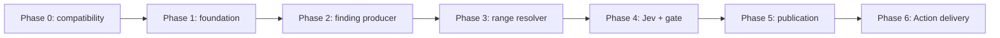

# 実装計画

Action本体はPhase 6（Action配布準備）とMVP受け入れ監査まで実装・検証済み（2026-10-03）。以下はフェーズ・成果物・完了条件の仕様。進捗管理機構は2026-10-03に削除済み（decisions.md D27）で、進捗・完了記録の正本は`docs/decisions.md`とgit履歴。

## Phase 0：外部仕様と実行方法の検証

**目的：本体を作る前に、Tool実行・設定隔離・投稿所有者・Jev接続を確かめる。** SDKや汎用adapter frameworkを先に導入しない。

実サービスの接続確認と、ローカルfixtureによる検証は区別して記録する。

**成果物：** `docs/decisions.md`にversion・起動方法・一時配置・隔離方法・JevのAPI対応表・未検証項目を記録。検証に使った最小fixtureを保存する。

**完了条件：** producerが自分でGitHub投稿しないこと、Coreが正式検証すること、1 invocationに1 Skillだけが適用されることを確認。NDJSONとJevの契約が実装可能である。未解決の接続項目には明確な依存先を残す。

**状態（2026-10-03）：完了。** 確定したcontractはv2 pluginテキストの`report_finding`（JSON Schema、importなし）、`@opencode/cli@2.0.22`の`opencode run --standalone`、JevはZen gateway（`jev-1.13-free`、認証付き較正は`JEV_API_KEY`依存）。producerがGitHub投稿しないこと、選択Skillだけが適用されること、NDJSONとJevの契約を確認した。検証結果は`docs/decisions.md`、Jevのmockとfixtureは`test/jev/`にある。

## Phase 1：小さな開発・Action基盤

開発用Node 26・pnpm 12はvpで固定済み。TypeScript strict、Valibot、esbuild、pnpm lockfile、型チェックとfixtureテスト、Action metadataを用意する。配布ActionはNode 24で動作するbuild targetとAPIを使う。

**状態（2026-10-03）：完了。** Node 26.8.2 / pnpm 12.6.0をvpで固定し、TypeScript strict（`erasableSyntaxOnly`・`verbatimModuleSyntax`）の型チェック、Node標準runnerのfixtureテスト66件、esbuild bundleとmetafile assertion（template text asset、valibot以外の依存なし）、`runs.using: node24`の`action.yml`、Docker `node:24-alpine` smoke（inputエラーとpipeline stub）まで確認した。bundle実測値はdecisions.md Q08に記録した。

**完了条件：** 最小entrypointがbundleされ、型・入力fixtureが通る。`@opencode/plugin` / Zod / Octokit / SDKがbundleに入らない。bundleの実測値を以後の比較基準として残す。

## Phase 2：OpenCode → 正式Finding

**完了条件：** fixtureのTool callから正式Findingが生成される。AIが`id` / `skill`を混入しても受理されない。OpenCode異常終了時は残存レコードを投稿用にしない。step間でTool・finding・sessionが混ざらない。

**状態（2026-10-03）：完了。** `ReviewContext`確定（GitHub metadataとlocal gitのHEAD・変更path突合、mismatchはrun error）、temp HOME管理config（v2 permissionsをconfigとagentの両層、選択SkillのHEADコピー、canary plugin）と固定HEAD workspace（`git archive` + 除外セット）、引数配列spawnとallowlist env（値衝突はspawn前run error、GITHUB_TOKEN / JEV_API_KEY非継承）、timeout / cancellation / 非ゼロ終了 / NDJSON破損 / 上限超過の分類、Coreの`id`（UUID）・`skill`付与、run error時に残存候補を使わないこと、全経路cleanupを実装。Node標準runnerのfixtureテストは141件green（github metadata・env builder・skill検証・NDJSONマトリクス・spawn/timeout/cleanup・pipeline結線）。bundleはraw 79887 bytes / gzip 19219 bytesで、template text assetとvalibotのみの依存assertionがgreen。実モデルlive smoke（`@opencode/cli@2.0.22`、`opencode/space-bunny-free`）でcanary出現・exit 0・`report_finding`経由のFinding取得・cleanupを実測（decisions.md D26）。

## Phase 3：Range Resolver

**完了条件：** 次の範囲fixtureが期待どおりに解決またはskipされる。範囲・code・SHAが同じHEADに属し、推測した行へ投稿しない。

**状態（2026-10-03）：完了。** `src/range.ts`を追加。`git diff -M --find-renames`のfull diff parser（rename/deleted/added/binary/hunk/RIGHT行、mode-only change、`\ No newline`、CRLF、空白・日本語path）、GitHub変更path集合との照合（Phase 2のrename正規化と整合、不一致はrun error）、path安全検査（絶対path・`..`・NUL・backslash拒否）と`git ls-tree -l`によるmode検査（120000/160000はskip）、`git show`blobの2 MiB / 50,000行上限とNUL binary判定、行末CRのみの正規化、完全一致anchor（候補内優先→候補外一意→複数は`anchor_ambiguous`）、同一hunk・変更行必須の最小範囲（anchor窓＋隣接added run）、固定reason code 13種と日本語メッセージ、`too_narrow`/`too_wide`のpure補正（±3行cap、attempt最大1、同一範囲で打ち切り）を実装。`main.ts`は全accepted findingをbatch解決して`review-result.json`へstage/reason/rangeを記録し、範囲解決後は末尾を`phase 4: jev validator is not implemented`で止める（`skipped-count`へ範囲skipを算入）。実git repo fixtureとparser fixtureでrange 61件、`node --test`全体205 pass、typecheck/build green。bundleはraw 102066 bytes / gzip 24692 bytes（Q08）。補正の確定条件はQ07に記録。Phase 4は`reResolveForCorrection`へ`buildDiffModel`と`readHeadBlob`の結果を渡して再評価を1回だけ行う。

## Phase 4：Jevと投稿判定

**完了条件：** 同じfixtureで同じgate結果になり、しきい値の境界と未知応答が検証できる。実サービスの評価結果とローカルmockを区別して記録する。全候補の検証前に投稿を開始しない。

**状態（2026-10-03）：完了。** `src/jev.ts`を追加：固定endpoint `https://opencode.ai/zen/v1/systemone`、`Authorization: Bearer`（`JEV_API_KEY`必須、D24）、`redirect: "manual"`で3xx拒否、応答はtext→`JSON.parse`（401は`text/plain`実測）、`finding.ts`のValibot schemaで欠損・型不一致・enum外・0–1範囲外をrun error（合格へ変換しない）、`cost`許容・`model` echoは記録のみ。再試行はattempts 3（別budget）、Retry-After ≤30sを厳守（超過は即失敗）、無指定時は1s指数backoff、per-attempt 60s timeout。401/403は即時、422はbodyの`server_error`（gateway/provider）と`invalid_request_error`（builder bug）を分類。`main.ts`は全accepted findingを順に検証し（`supported >= 0.7`・`commentWorthy >= 0.6`・`rangeQuality === "correct"`、`>=`）、範囲のみ不合格なら`reResolveForCorrection`＋Jev再評価を最大1回、同一・不能は`range_retry_exhausted`で打ち切り。stateは実diff/blobの`buildJevEvidence`とHEAD SKILL.md本文（8000 code units上限）から構成し、超過は`evidence_overflow`でskip。全検証後に`publishables`をresult fileへstagingし、末尾を`phase 5: publisher not implemented`で止める。fixtureテストは242 pass（Phase 4追加37：transport 20、gate決定、ladder golden、stage統合）。実サービス較正（匿名`jev-1.13-free`、6ケース）は正例2/2合格・誤指摘2/2不合格・wrong_location検出、too_wide例は`correct`判定（限界はQ06に記録）。bundleはraw 126974 bytes / gzip 30314 bytes（Q08）。認証付き較正は`JEV_API_KEY`待ち（残存依存）。

## Phase 5：dry-runとGitHub inline投稿

**完了条件：** 1 findingが1 inline commentになる。dry-runはPOSTなし。HEAD変更時は残りを止める。失敗後に投稿済みコメントを無条件再送しない。

**状態（2026-10-03）：完了。** `src/github.ts`へ`buildInlinePayload`（`[severity] title\n\nbody`、単一行は`start_line`/`start_side`省略、複数行は`start_line`/`start_side=RIGHT`、`position`不使用）と`postInlineComment`（`POST /repos/{o}/{r}/pulls/{n}/comments`、201の`id`/`url`を検証、error bodyはtext-firstで解析）を追加。`main.ts`は全finding検証後にD17の完全一致重複排除（`dedupePublishables`、`commitId`/path/範囲/side/severity/title/body）を行い、gate planを`status:"staged"`で結果ファイルへ先に書く。dry-runは同一payloadとskip理由をstdout JSONへ出してPOST 0回・exit 0。本番は`publishFindings`が各POST直前にHEAD再確認し、HEAD移動・403/422/5xx・network/ambiguous timeout・201 schema不正のいずれでも残りを停止して成功comment IDと未投稿候補（ambiguous含む）を記録、盲目的再送なし（D18）。結果ファイルは`publishables[]`へpayload/commentId/url/stage(planned|posted|unposted)、`findings[]`へpublish stage、`dedup`、`publish.failure`、counts（deduped含む）を保存。GITHUB_OUTPUTの5キー（accepted/publishable/published/skipped/result-path）は全終端経路でbest-effort出力（run error時は0と空result-path）。テストは263 pass（Phase 5追加21: payload/post 9、publisher unit+統合12）、`node --test test/jev/` 14 pass、typecheck・build green、bundle raw 136799 / gzip 32300（Q08 5点目）。live検証（scratch repo `50ki-1706/opencode-review-scratch` PR #1、実測 partial: producerのみfake CLI、context/range/Jev/投稿は本番）でdry-run payload 2件・実投稿2件（単一行line 2、複数行start_line 12/line 14、comment id 4168309537 / 4168309817）を`gh api`で照合。422実測2種（path不在・line範囲外）とstale `commit_id`の201受理（現在HEADへ正規化、`original_commit_id`保持）を記録し、HEAD移動stop（stage=context）も実測。詳細はdecisions.md Phase 5同期とQ10。実モデル（`opencode/space-bunny-free`）2回はanchorの先頭空白欠落で`anchor_not_found`となり、verbatim率の改善はPhase 6以降の残存課題。

## Phase 6：GitHub Actionとして配布可能にする

**完了条件：** 専用PRで一連の処理を確認し、再現可能な配布物と利用文書が揃う。公開・リリースは別途その作業を依頼された段階で行う。

**状態（2026-10-03）：実装・ローカル検証は完了。hosted E2Eの完全実行のみActions secret `JEV_API_KEY`待ち（部分実測は取得済み）。** `examples/pr-review.yml`（events / concurrency / 同一リポジトリguard / 最小権限 / `head.sha`+`fetch-depth:0` checkout / `@opencode/cli@2.0.22`導入 / 2 Skill別step / `JEV_API_KEY`）、`test/live/two-skill-check.mjs`（built distを2 Skillで連続実行し、staging cleanup・result/output分離・cross-runなしをassert）、`.github/workflows/ci.yml`（typecheck・全テスト・Jev契約・build・`git diff --exit-code -- dist/`・build:verify・two-skill・bundle:check・actionlint v1.7.12・dist-only smoke）、`docs/bundle-baseline.json`（+15% policy、baseline raw 137271 / gzip 32449）、`scripts/check-bundle.mjs`（size / determinism。2回buildのraw sha256 `1ce9dec5…` とgzip sha256 `dd67a9f4…` が一致、checked-in distとfresh buildが一致）、`test/smoke/`（node:24-alpineに`dist/index.js`のみコピーし、JEV欠如→`stage:"environment"`、dummy key→`stage:"context"`の2ケースをローカル実測）を追加した。anchor promptは「read tool出力から先頭空白込みで逐語コピー」へ改善したが、実モデル2回4件は依然先頭空白欠落でskip（0件runは正常扱い、残存課題）。hostedはscratch repo `50ki-1706/opencode-review-scratch` mainへ`action.yml`+`dist/`+self-review workflow（`uses: ./`）をdeployし、PR #2（clamp境界の2行欠陥）でrun 37081080875を実行：checkoutと`npm install -g @opencode/cli@2.0.22`（added 5 packages）はsuccess、Reviewは`JEV_API_KEY`未設定のため`{"class":"run_error","stage":"environment","fields":["JEV_API_KEY"]}`でfailure。secret設定後に`gh run rerun 37081080875 -R 50ki-1706/opencode-review-scratch`で完走確認する。PR #1とコメント3件は保持。

## 必要な検証ケース

| 対象 | ケース |
| --- | --- |
| Finding入力 | 空文字、空白のみ、非整数、負数、NaN相当の不正入力、start > end、未知severity、未知フィールド |
| path | 未変更、絶対path、`..`、symlink、削除file、renameの新path、空白・日本語を含むpath |
| NDJSON | 正常0件、複数件、同時追記、壊れた行、部分行、ファイル消失、件数・byte上限、異常終了後の残存 |
| diff / anchor | 新規file、複数hunk、CRLF、末尾改行なし、候補行ずれ、一意一致、複数一致、anchor不在、binary、diff外 |
| 範囲 | 単一行、複数行、削除行混在、hunk跨ぎ、contextのみ、too_narrow / too_wide補正、再評価上限 |
| Jev | 正常、threshold直下 / 一致 / 直上、欠損question ID、type不一致、未知Choice、範囲外値、429 / 5xx / timeout |
| 投稿 | 正しいSHAとpath、単一行パラメータ省略、dry-run POST 0回、HEAD変更、403 / 422、途中失敗、応答不明、完全一致重複 |
| 隔離 | PR内の設定・plugin・Tool、provider認証以外のsecret非継承、別Skill・別session・別NDJSONの混入防止 |
| 隔離（Phase 0実測） | 認証情報の値衝突でspawn拒否、PWD不一致の防止、`/etc/opencode`非読込、decoy config不出現、Skill相対参照（`external_directory`は`<skill dir>/*`許可） |

Jev契約のmockとfixtureの検証は`test/jev/`（`node --test test/jev/`）で行う。Phase 1以降はこの契約をValibot schemaへ移す。

構造や境界はfixtureで検証し、AIの指摘内容が毎回同じになることを合否条件にしない。実モデルの確認では、結果品質・費用・待ち時間をfixtureテストとは別に記録する。

## MVP全体の完了条件

全体の受け入れ条件は本ドキュメントのMVP節（および`docs/decisions.md`の受け入れ記録）に保持する。1 Skill / 1 session、Tool入力によるFinding取得、範囲と根拠の検証、固定HEADへのinline投稿、dry-run、最小依存、障害の区別を満たすことを確認する。

**状態（2026-10-03）：mvp-01〜08すべて完了。** mvp-02〜08は証拠監査で完了（fresh validationすべてexit 0、詳細は`docs/decisions.md`「MVP受け入れ（2026-10-03）」）。mvp-01はhosted run 37081080875 attempt 3（scratch repo PR #2、`JEV_API_KEY`設定後）がsuccessで完走（全step success、投稿0件はfreeモデルのanchor caveatによる正常扱い）。残る作業は配布確定（Q09）とanchor verbatim率の改善。
